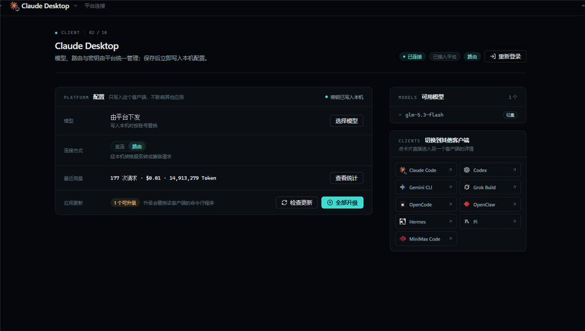

<div align="center">

# AIFusion

**一个桌面控制台，把 AIFusion 平台的模型接入十个 AI 编程客户端。**

登录一次，密钥自动下发；模型、路由、用量与客户端更新，都在一个窗口里完成。

[](https://github.com/aivoai7/aifusion-desktop/releases)
[](https://github.com/aivoai7/aifusion-desktop/releases/latest)
[](https://tauri.app/)

**[下载](https://github.com/aivoai7/aifusion-desktop/releases/latest) · [首次使用](#首次使用) · [功能](#功能) · [开发](#开发与构建)**

</div>



## 这是什么

AIFusion 是 AIFusion 平台的桌面客户端，支持 Windows 与 Linux。它只对接自有平台，不预置任何第三方配置，只做一件事：把平台账号、API Key 与模型配置，可靠地写进你正在使用的 AI 编程工具。

- 平台地址：<https://op.aifusion.sbs>
- 安装包不包含任何 API Key；首次使用时通过网页登录取回你自己的 Key
- 不需要手改 JSON / TOML / YAML，客户端配置由应用写入
- 当前版本 **0.2.4**，Windows 与 Linux 各出 x64/x86_64 与 ARM64 安装包

支持的客户端：

- **终端**：Claude Code、Codex、Gemini CLI、Grok Build、OpenCode、OpenClaw、Hermes、Pi、MiniMax Code
- **桌面**：Claude Desktop

## 功能

### 一次登录，自动下发

点「登录平台」后，应用用系统浏览器打开官网；你在网页里完成登录，应用自动取回一把可用的 API Key，存进本机 SQLite，并写入各客户端的「AIFusion 平台」配置。正在使用平台配置的客户端会立即刷新，其余客户端在切回平台配置时生效。

账号密码与官网 Cookie 不会保存在应用里。

### 总览

打开就是总览：平台连接状态、钱包余额、已接入客户端、平台可用模型、最常用模型、近 7 天用量和客户端更新，一屏可见。顶栏余额每分钟从平台刷新一次。

### 客户端详情

点任意一行客户端进入详情。左边是一张规格表：主模型、连接方式、最近用量、应用更新；右边列出平台可用模型，以及其他客户端的快捷入口。Claude Code 与 Claude Desktop 还有独立的轻量模型槽位。

### 直连与本机路由

Claude Code、Claude Desktop、Codex、Gemini CLI、Grok Build 可以按客户端切换「直连」或「路由」：总览有一键「全部走路由」，详情页每个客户端各有一个开关。路由由本机服务转发，客户端只看到本地地址；端口、故障转移与路由策略使用内置默认值，界面不再提供修改入口。

### 用量统计

按时间范围查看请求数、Token 与费用，能下钻到单次请求；另有模型统计和显示设置。统计来自本机会话记录，按客户端与模型汇总。

### 应用更新

在详情页检查客户端命令行程序的版本，有更新时一键升级；首页会汇总待更新的数量。

### 五种界面语言

内置简体中文、繁體中文、English、日本語、Türkçe 五种界面语言：启动时跟随系统语言，本机记录过语言偏好时沿用它。

## 下载与安装

系统要求：

- **Windows**：Windows 10 / 11，x64 与 ARM64 都有包，需要 Microsoft Edge WebView2 Runtime（Windows 11 自带）
- **Linux**：x86_64 与 ARM64，GNOME/KDE 桌面 + GTK3 / WebKit2GTK 4.1（桌面发行版通常自带）

从 [Releases](https://github.com/aivoai7/aifusion-desktop/releases/latest) 下载：

| 文件 | 用途 |
| --- | --- |
| `AIFusion-v0.2.4-Windows-setup.exe` | NSIS 安装包，Windows x64 推荐绝大多数用户使用 |
| `AIFusion-v0.2.4-Windows.msi` | MSI 安装包，适合企业批量分发 |
| `AIFusion-v0.2.4-Windows-Portable.zip` | Windows x64 免安装版，解压即用 |
| `AIFusion-v0.2.4-Windows-arm64.msi` | Windows ARM64 MSI |
| `AIFusion-v0.2.4-Windows-arm64-Portable.zip` | Windows ARM64 免安装版，解压即用 |
| `AIFusion-v0.2.4-Linux-x86_64.AppImage` | Linux x86_64 通用包，chmod +x 后直接运行，跨发行版首选 |
| `AIFusion-v0.2.4-Linux-x86_64.deb` | Debian / Ubuntu |
| `AIFusion-v0.2.4-Linux-x86_64.rpm` | Fedora / openSUSE / RHEL 系 |
| `AIFusion-v0.2.4-Linux-arm64.{AppImage,deb,rpm}` | 以上三种的 ARM64 版本，命名同 x86_64 |

> 如果你安装过 4.0.15 或更早的版本，请先卸载旧版再安装 0.2.4。版本号回退时，Windows 安装器可能拒绝覆盖升级。

deb/rpm 的依赖名按 Ubuntu 22.04 一代的包写死。本机在 Ubuntu 26.04（WSL2）实测：`libgtk-3-0` 已完成 t64 迁移改名 `libgtk-3-0t64`，`apt install ./xxx.deb` 会报依赖不满足；装法是先手动装齐 GTK3、WebKit2GTK 4.1、AppIndicator3、libnotify、xdg-utils，再用 `sudo dpkg -i --force-depends xxx.deb`，或直接改用 AppImage。

macOS 仍未提供预编译包，需自行从源码构建。

## 首次使用

1. 启动 AIFusion。
2. 在总览右上角点「登录平台」，或进入任一客户端详情点「登录平台」。
3. 系统浏览器会打开 <https://op.aifusion.sbs>，完成登录或注册。
4. 回到应用，等待「等待网页登录完成…」结束，状态变为「已连接」。
5. 点进客户端确认模型与连接方式。如果该客户端当时正在运行，重启它让新配置生效。

需要换账号或 Key 失效时，直接在总览右上角或客户端详情右上角点「重新登录」，应用会重新打开官网并取回新的 Key。

## 数据与隐私

- API Key 保存在本机 `~/.aifusion/aifusion.db`（SQLite），并写入你使用的客户端配置
- 应用配置、日志同样位于 `~/.aifusion`
- 平台登录在系统浏览器完成，官网账号与 Cookie 不写入应用
- 安装包与源码中不包含任何平台密钥

在 Windows 上，`~` 指当前用户目录，例如 `C:\Users\<用户名>`；在 Linux 上指 `$HOME`，例如 `~/.aifusion`。

## 开发与构建

依赖：

| 依赖 | 版本 |
| --- | --- |
| Node.js | 20.19+ |
| pnpm | 10（仓库锁定 10.12.3） |
| Rust | 1.95（见 `rust-toolchain.toml`） |
| Tauri | 2.x |

Windows 还需要 MSVC Build Tools 与 WebView2 Runtime。

```bash
pnpm install

pnpm dev              # 启动 Vite + Tauri 开发窗口
pnpm typecheck        # TypeScript 类型检查
pnpm test:unit        # Vitest 单元测试
pnpm format:check     # Prettier 检查

pnpm build:renderer   # 只构建前端到 dist/
pnpm tauri build --bundles nsis,msi   # 打包 Windows 安装包
pnpm tauri build --bundles appimage,deb,rpm   # 打包 Linux 安装包
```

Linux 上构建前需要这些开发库（Release 工作流里装的就是这一组）：

```bash
sudo apt-get install -y build-essential pkg-config file patchelf rpm xdg-utils \
  libssl-dev libgtk-3-dev librsvg2-dev libayatana-appindicator3-dev \
  libwebkit2gtk-4.1-dev libsoup-3.0-dev
```

安装包输出位置：

```text
src-tauri/target/release/bundle/nsis/AIFusion_<version>_x64-setup.exe
src-tauri/target/release/bundle/msi/AIFusion_<version>_x64_en-US.msi
src-tauri/target/release/bundle/appimage/AIFusion_<version>_amd64.AppImage
src-tauri/target/release/bundle/deb/AIFusion_<version>_amd64.deb
src-tauri/target/release/bundle/rpm/AIFusion-<version>-1.x86_64.rpm
```

目录结构：

```text
src/                 React 18 + TypeScript 界面
src-tauri/           Tauri 2 外壳、命令、托盘
native/engine/       Rust 引擎：配置读写、SQLite、路由与平台服务
tests/               Vitest 测试
docs/readme/         README 截图
```

版本号同时写在 `package.json`、`src-tauri/tauri.conf.json` 与 `src-tauri/Cargo.toml`。推送 `v*` 标签会触发 Release 工作流；应用内更新摘要放在 `src/whats-new/<version>.json`。

## 许可

MIT，见 [LICENSE](LICENSE)。
